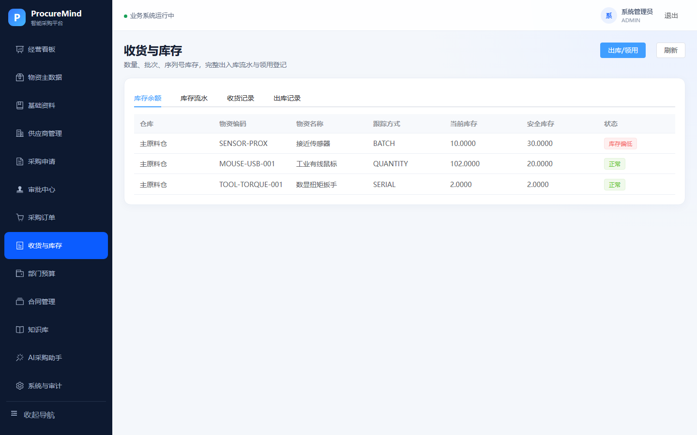
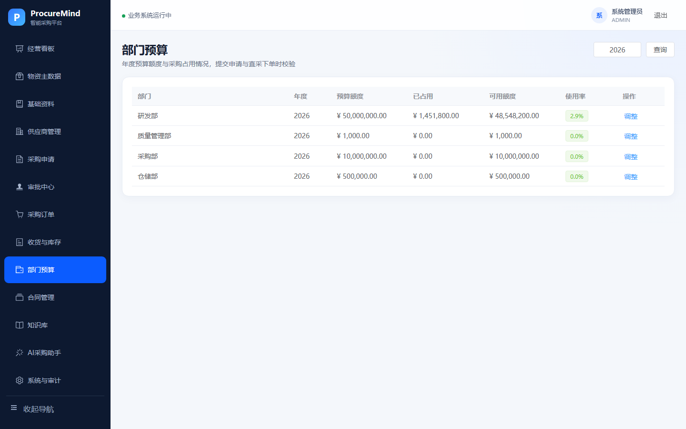
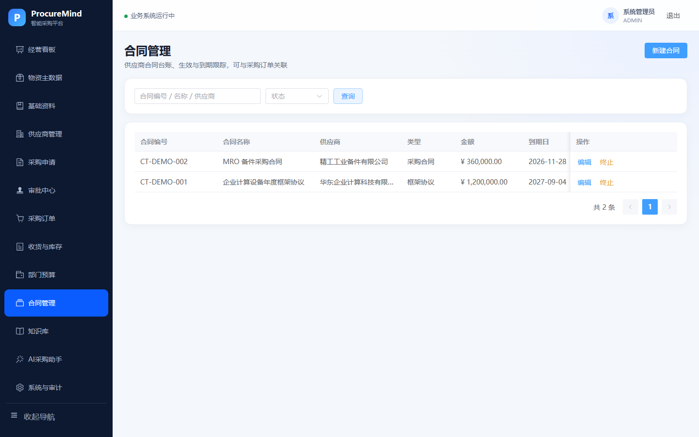
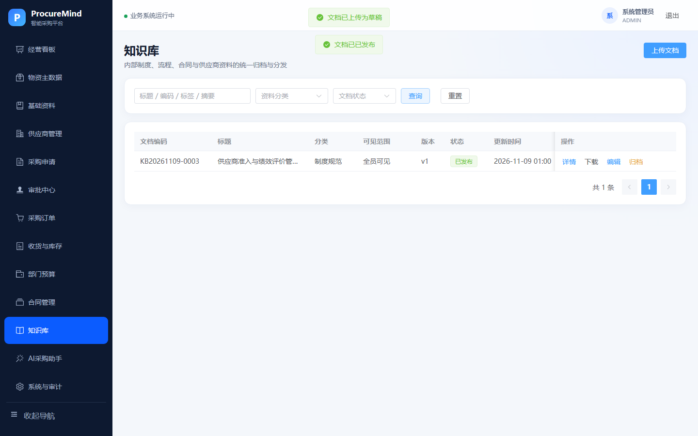
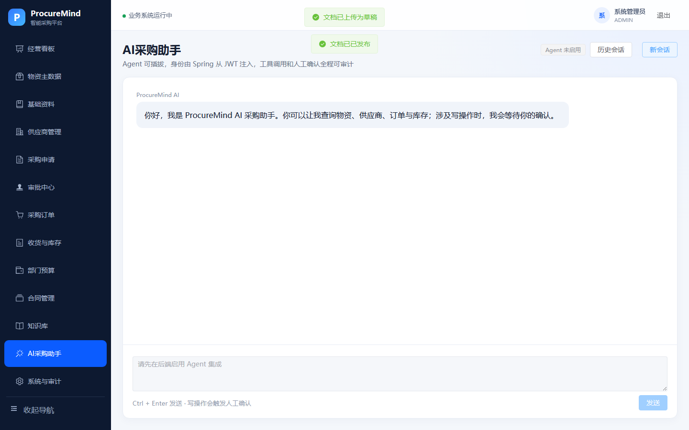
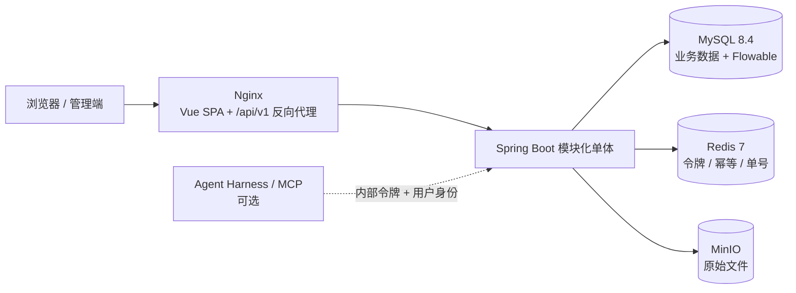

# ProcureMind 智能采购平台

[](https://github.com/q2392044156/smart-procurement-platform/actions/workflows/ci.yml)
[](LICENSE)
[](backend/pom.xml)
[](frontend/package.json)

面向制造企业的工业物资采购平台，覆盖“采购申请 → 多级审批 → 采购订单 → 分批收货 → 库存入账 → 领用出库 → 预算/合同/看板”的完整闭环。

前后端业务系统与 `procurement-agent-harness` 解耦：不启动 Agent 时，平台所有业务功能可以独立运行；需要自然语言采购助手时，再按可选方式接入。


## 界面展示

| 经营看板 | 库存台账 |
|---|---|
|  |  |

| 部门预算 | 合同台账 |
|---|---|
|  |  |

| 知识库 | 智能采购助手 |
|---|---|
|  |  |

> 更多界面与 6 帧演示 GIF：`docs/screenshots/demo.gif`。

## 项目结构

```text
smart-procurement-platform/
├── backend/                 # Spring Boot 模块化单体、Flyway、Flowable
├── frontend/                # Vue 3 管理端
├── infra/                   # MinIO 等基础设施配置
├── sql/                     # 12 个月业务演示数据与导入脚本
├── samples/                 # 知识库示例文档与生成脚本
├── docs/                    # 架构说明、截图等
├── compose.yml              # Docker Compose 一键启动
└── .env.example             # 环境变量模板
```

## 项目架构



- 浏览器只访问 `/api/v1/**`；`/api/**` 是 Agent 内部工具面，不通过 Nginx 暴露。
- 业务权限、数据范围、状态机、幂等和审计由平台裁决，Agent 只负责理解与编排。
- 业务模块通过公开 Service 与扩展点协作，文件、知识库、预算、合同之间不直接访问内部实现。

## 技术架构

| 层 | 技术 |
|---|---|
| 前端 | Vue 3、TypeScript、Vite、Pinia、Element Plus、ECharts |
| 后端 | Java 21、Spring Boot 3.5、Spring Security、JdbcTemplate、Flowable 7.2、Flyway |
| 基础设施 | MySQL 8.4、Redis 7、MinIO、Docker Compose |
| 可选智能能力 | FastAPI、LangGraph、deepagents、MCP、DeepSeek、Qdrant、MongoDB |

## 实现功能

### 采购业务闭环

- 采购申请：创建、编辑草稿、提交、取消、驳回后重提、软删除；
- 多级审批：按金额进入部门经理、采购经理、财务、总经理审批链；
- 采购订单：由已批准申请转换，或直接创建；支持编辑、提交、取消、关闭、删除；
- 分批收货：支持数量、批次号、序列号三种物资跟踪方式；
- 库存台账：收货入库、领用出库、批次/序列号库存、库存余额与流水；
- 部门预算：年度额度维护，申请/下单时校验可用额度，展示占用与使用率；
- 合同台账：合同编号、供应商、金额、起止日期、类型及订单关联。

### 主数据与供应商

- 物资分类、物资、品牌、单位、仓库的增删改查与启停；
- 物资动态属性：文本、数值、布尔、日期、枚举；
- 供应商档案、多联系人、准入/合格/暂停/黑名单状态；
- 供应商资质附件、有效期提醒、季度绩效评价与综合评分；
- 已有采购/库存引用的数据删除与停用保护。

### 看板、提醒与审计

- 经营看板：采购趋势、订单状态、供应商排名、预算使用情况；
- 提醒：资质临期/过期、交付临期/逾期、审批积压；
- 操作审计：关键写操作留痕，支持按角色和范围查询；
- 用户、组织、角色、权限、数据范围管理。

### 知识库

- DOCX、PDF、Excel、PPT、文本等文档上传与归档；
- 分类、标签、归属部门、五档可见范围；
- 草稿、发布、归档状态流转，版本历史与回滚；
- 权限校验下载、文件引用保护。

### 智能采购助手（可选）

- 自然语言查询供应商、物资、库存、订单、预算和知识库；
- 采购分析、图表生成、文档生成；
- 9 个写工具强制人工确认（HITL），支持中断恢复；
- 知识库混合检索、引用与无依据拒答；
- Agent 不可用时，不影响平台业务接口。

## 完整启动与关闭

### 前置条件

- Git
- Docker Desktop / Docker Engine
- Docker Compose v2
- 本机 `3000`、`8080`、`9000`、`9001` 端口未被占用

### 启动

```powershell
git clone https://github.com/q2392044156/smart-procurement-platform.git
cd smart-procurement-platform
Copy-Item .env.example .env

docker compose up -d --build
docker compose ps
```

正常运行时 `mysql`、`redis`、`minio`、`backend` 应为 `healthy`，`frontend` 应为 `Up`。

```powershell
docker compose logs -f backend frontend
```

### 访问入口

| 入口 | 地址 |
|---|---|
| 管理端 | http://localhost:3000 |
| Swagger | http://localhost:8080/swagger-ui.html |
| 后端健康检查 | http://localhost:8080/actuator/health |
| MinIO 控制台 | http://localhost:9001 |
| Agent API（可选） | http://localhost:8000/health |
| MCP SSE（可选） | http://localhost:8001/sse |

### 可选：导入完整业务演示数据

首次启动只有主数据和知识库。需要 12 个月、120 张订单的演示数据时：

```powershell
.\sql\apply_demo_data.ps1
```

数据包括 56 张申请、120 张采购订单、95 张收货单、48 张领料、401 条库存流水、13 份合同，订单总额约 900 万元。

如果同时克隆了 `../procurement-agent-harness`，也可以一键清库并重建：

```powershell
..\procurement-agent-harness\scripts\reset_demo.ps1 -Agent -WithBusiness
```

### 可选：启动 Agent

确保 `../procurement-agent-harness/.env` 已准备，并在平台 `.env` 中设置至少 32 位的 `AGENT_INTERNAL_TOKEN`：

```powershell
$env:AGENT_ENABLED='true'
docker compose --profile agent up -d --build
```

### 关闭

```powershell
# 停止服务，保留 MySQL / Redis / MinIO 数据
docker compose down

# 如果启用了 Agent
docker compose --profile agent down

# 只停止前后端，保留基础设施
docker compose stop frontend backend

# 恢复
docker compose start
```

> `docker compose down -v` 会删除数据库、缓存、MinIO 文件以及 Agent 的 MongoDB/Qdrant 数据卷，仅在确认清空全部数据时使用。

## 演示账号

| 角色 | 账号 | 密码 |
|---|---|---|
| 系统管理员 | `admin` | `Admin@123` |
| 申请人 | `requester` | `Request@123` |
| 部门经理 | `manager` | `Manager@123` |
| 采购员 | `purchaser` | `Purchase@123` |
| 财务 | `finance` | `Finance@123` |
| 仓管员 | `warehouse` | `Warehouse@123` |
| 总经理 | `gm` | `Gm@123` |
| 审计员 | `auditor` | `Audit@123` |
| 质量部门经理（扩展） | `quality` | `Quality@123` |
| 质量部申请人（扩展） | `quality.requester` | `QualityReq@123` |
| 主数据管理员（扩展） | `masterdata` | `MasterData@123` |
| 供应商管理员（扩展） | `supplieradmin` | `Supplier@123` |
| 采购只读观察员（扩展） | `viewer` | `Viewer@123` |

审批规则：5 万元以下由部门经理、采购经理审批；5 万至 50 万元增加财务；50 万元及以上增加总经理。申请人兼任当前审批角色时自动跳过该节点。

## 边界与安全说明

- 本项目是面试展示型 MVP，不等同于生产级 ERP。询报价、发票、三单匹配、质检、资产维保、消息通知和多租户不在当前范围。
- 所有演示密码、`.env` 密钥和 MinIO 凭据仅用于本地演示；部署到服务器前必须全部更换。
- Compose 默认只绑定 `127.0.0.1`；对外部署应使用 HTTPS，并限制 Swagger 和 MinIO 控制台访问。
- 文件上传已限制类型、大小、删除条件与下载者身份；生产环境仍建议增加病毒扫描和对象生命周期策略。
- 远程部署时 `MINIO_PUBLIC_ENDPOINT` 必须改为浏览器可访问的 HTTPS 地址。
- 内部 `/api/**` 不通过 Nginx 暴露，并校验内部令牌、用户身份和业务权限。
- Agent 不持有超级权限；写操作需人工确认，平台仍是权限和数据的最终裁决方。

## License

本项目采用 [MIT License](LICENSE)，Copyright (c) 2026 WangQF。
