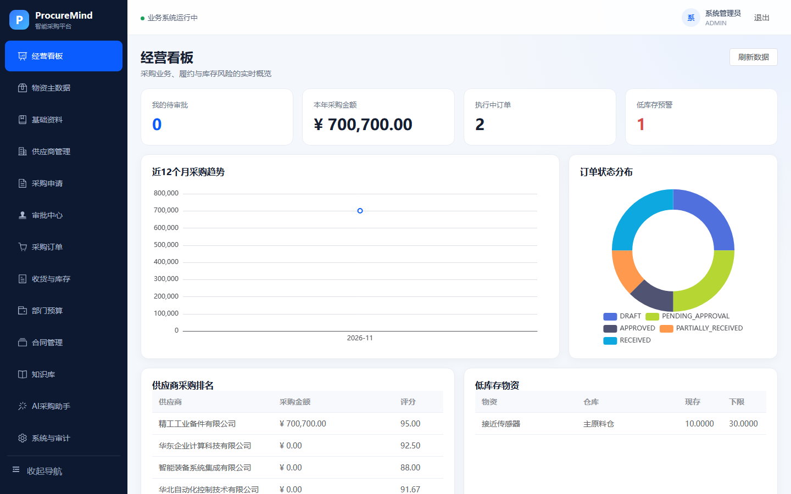
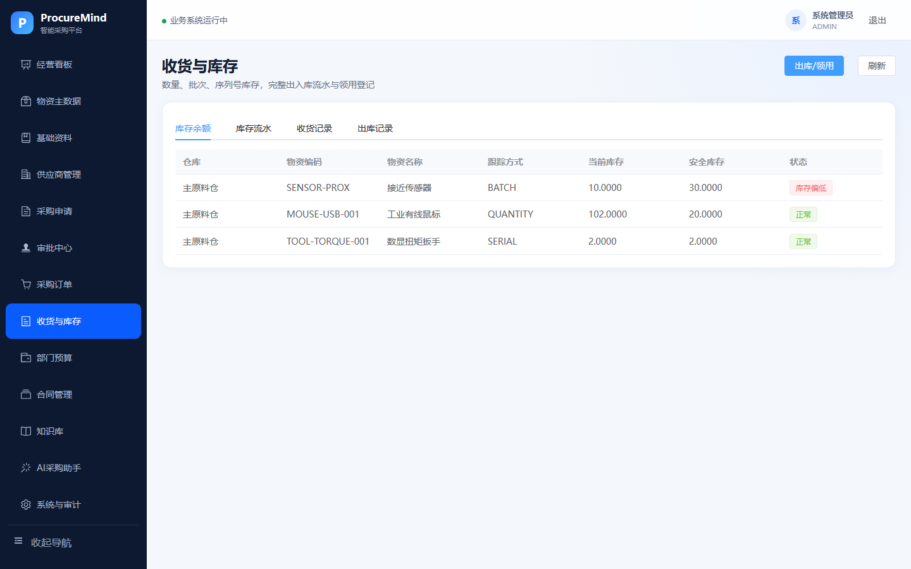
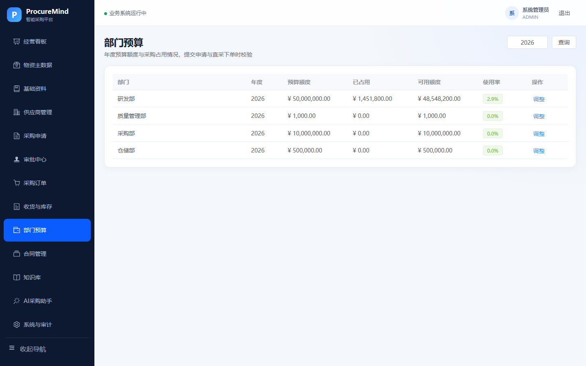
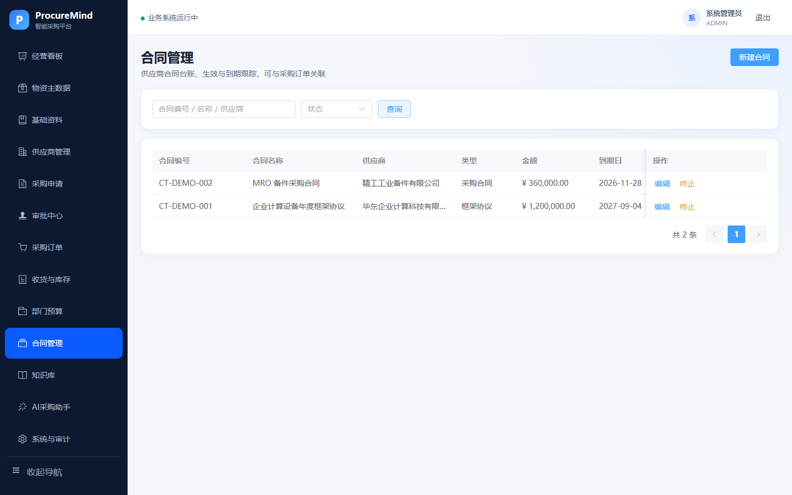
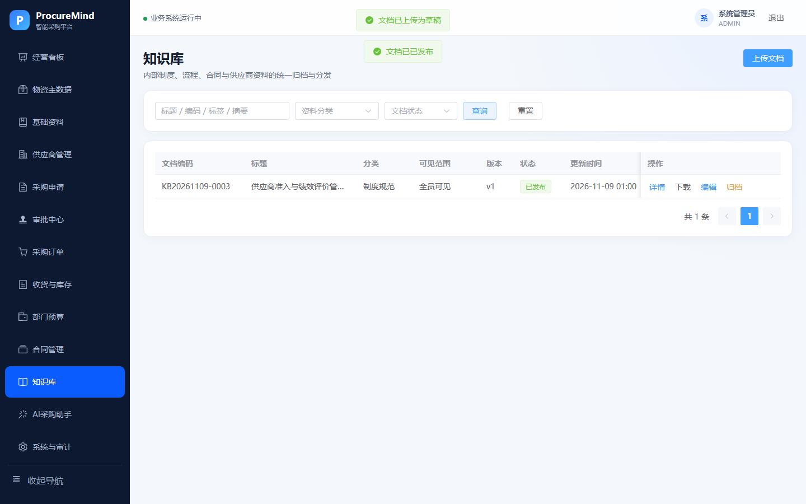
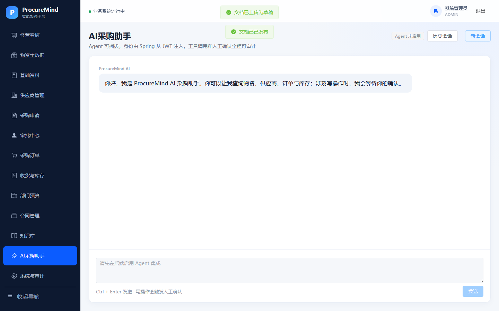
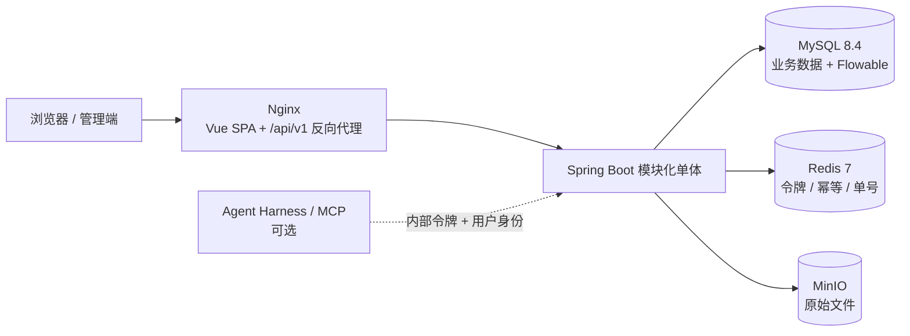

# ProcureMind 智能采购平台

[](https://github.com/q2392044156/smart-procurement-platform/actions/workflows/ci.yml)
[](LICENSE)
[](backend/pom.xml)
[](frontend/package.json)

面向制造企业的工业物资采购平台，覆盖“采购申请 → 多级审批 → 采购订单 → 分批收货 → 库存入账 → 领用出库 → 预算/合同/看板”的完整闭环。

前后端业务系统与 `procurement-agent-harness` 解耦：不启动 Agent 时，平台所有业务功能可以独立运行；需要自然语言采购助手时，再按可选方式接入。



## 界面展示

| 经营看板 | 库存台账 |
|---|---|
|  |  |

| 部门预算 | 合同台账 |
|---|---|
|  |  |

| 知识库 | 智能采购助手 |
|---|---|
|  |  |

> 更多界面与 6 帧演示 GIF：`docs/screenshots/demo.gif`。

## 项目结构

```text
smart-procurement-platform/
├── backend/                              # Spring Boot 单体应用（按层分包）
│   ├── src/main/java/com/procuremind/platform/
│   │   ├── ProcureMindApplication.java   # 启动类
│   │   ├── controller/                   # 22 个 REST 入口：路由、校验、权限注解
│   │   ├── service/                      # 27 个业务服务：状态机、事务编排
│   │   ├── mapper/                       # 21 个 MyBatis 接口：数据访问，SQL 在 resources/mapper
│   │   ├── pojo/                         # 响应体 ApiResponse、TokenPair；request/ 下 41 个请求 record
│   │   ├── exception/                    # BusinessException、全局异常处理
│   │   ├── filter/                       # JWT、RequestId、内部 Agent 认证
│   │   ├── aop/                          # 审计切面
│   │   ├── anno/                         # CurrentUser 注解
│   │   ├── utils/                        # SecurityUtils、LegacyStatus
│   │   └── config/                       # Security、MinIO、Jackson、OpenAPI、演示数据
│   ├── src/main/resources/
│   │   ├── mapper/                       # 21 份 MyBatis XML：全部 SQL 语句
│   │   ├── db/migration/                 # Flyway V1~V13：表结构/主数据/演示数据/权限补丁
│   │   └── processes/                    # 申请、订单的 Flowable BPMN
│   ├── src/test/java/...                 # 单元、集成、架构约束测试
│   └── pom.xml
│
├── frontend/                             # Vue 3 管理端
│   ├── src/
│   │   ├── views/
│   │   │   ├── auth/                     # 登录
│   │   │   ├── dashboard/                # 经营看板
│   │   │   ├── requisition/              # 采购申请
│   │   │   ├── workflow/                 # 审批中心
│   │   │   ├── purchaseorder/            # 采购订单
│   │   │   ├── inventory/                # 收货、库存、领料
│   │   │   ├── budget/                   # 部门预算
│   │   │   ├── contract/                 # 合同台账
│   │   │   ├── supplier/                 # 供应商
│   │   │   ├── masterdata/               # 物资/基础资料
│   │   │   ├── knowledge/                # 知识库
│   │   │   ├── agent/                    # 智能采购助手
│   │   │   └── system/                   # 用户/角色/组织/审计
│   │   ├── components/                   # 业务组件：附件、审批时间线、聊天图表附件
│   │   ├── utils/                        # Markdown 渲染、附件链接识别、时间与数量格式化
│   │   ├── layouts/                      # 管理端布局
│   │   ├── router/                       # 路由与权限守卫
│   │   ├── stores/                       # Pinia 状态
│   │   ├── api/                          # 唯一 Axios 实例、401 刷新重放、文件下载
│   │   ├── types/                        # TypeScript 类型
│   │   ├── assets/                       # 全局样式与静态资源
│   │   └── tests/                        # Vitest 单元测试（Markdown/附件/鉴权/SSE）
│   ├── e2e/                              # Playwright 浏览器测试（登录导航/业务/知识库/助手）
│   └── package.json
│
├── sql/                                  # 12 个月业务演示数据
│   ├── demo_business_data.sql            # 120 张订单及库存/价格流水
│   ├── apply_demo_data.ps1               # 一键导入
│   └── README.md
│
├── scripts/                              # 启动、演示数据与验收脚本
│   ├── demo-up.ps1                       # 一键启动/停止（含端口冲突处理）
│   ├── seed-showcase-data.ps1            # 演示单据生成
│   ├── install-git-hooks.ps1             # 安装提交规范钩子（作者身份校验）
│   └── *-smoke.ps1 / *.py                # 业务与 Agent 接口验收
│
├── infra/minio/                          # MinIO 镜像配置
├── samples/knowledge/                    # 知识库示例文档
├── docs/                                 # 架构、Agent 工具契约、部署、演示与截图
│   └── screenshots/                      # README 使用的界面截图
│
├── .github/workflows/ci.yml              # 后端/前端/Playwright CI
├── compose.yml                           # Docker Compose 一键启动
├── .demo-override.yml                    # 端口覆盖（9000 被占用时由脚本自动生成）
├── .env.example                          # 环境变量模板
├── LICENSE
└── README.md
```

后端按层分包，依赖方向固定为 `controller → service → mapper`：Controller 只做路由、参数校验与权限注解，Service 负责状态机与事务编排，Mapper 接口配 `resources/mapper/*.xml` 承载全部 SQL。层间约束由 `backend/src/test/java/com/procuremind/platform/ArchitectureTest.java` 守住（Controller/Service 不得直接使用 `JdbcTemplate`，Service/Filter 不得依赖 Controller）。


## 项目架构



- 浏览器只访问 `/api/v1/**`；`/api/**` 是 Agent 内部工具面，不通过 Nginx 暴露。
- 业务权限、数据范围、状态机、幂等和审计由平台裁决，Agent 只负责理解与编排。
- 业务模块通过公开 Service 与扩展点协作，文件、知识库、预算、合同之间不直接访问内部实现。

## 技术架构

| 层 | 技术 |
|---|---|
| 前端 | Vue 3、TypeScript、Vite、Pinia、Element Plus、ECharts；Vitest + Playwright 测试 |
| 后端 | Java 21、Spring Boot 3.5、Spring Security、JdbcTemplate、Flowable 7.2、Flyway |
| 基础设施 | MySQL 8.4、Redis 7、MinIO、Docker Compose |
| 可选智能能力 | FastAPI、LangGraph、deepagents、MCP、DeepSeek、Qdrant、MongoDB |

## 实现功能

### 采购业务闭环

- 采购申请：创建、编辑草稿、提交、取消、驳回后重提、软删除；
- 多级审批：按金额进入部门经理、采购经理、财务、总经理审批链；
- 采购订单：由已批准申请转换，或直接创建；支持编辑、提交、取消、关闭、删除；
- 分批收货：支持数量、批次号、序列号三种物资跟踪方式；
- 库存台账：收货入库、领用出库、批次/序列号库存、库存余额与流水；
- 部门预算：年度额度维护，申请/下单时校验可用额度，展示占用与使用率；
- 合同台账：合同编号、供应商、金额、起止日期、类型及订单关联。

### 主数据与供应商

- 物资分类、物资、品牌、单位、仓库的增删改查与启停；
- 物资动态属性：文本、数值、布尔、日期、枚举；
- 供应商档案、多联系人、准入/合格/暂停/黑名单状态；
- 供应商资质附件、有效期提醒、季度绩效评价与综合评分；
- 已有采购/库存引用的数据删除与停用保护。

### 看板、提醒与审计

- 经营看板：采购趋势、订单状态、供应商排名、预算使用情况；
- 提醒：资质临期/过期、交付临期/逾期、审批积压；
- 操作审计：关键写操作留痕，支持按角色和范围查询；
- 用户、组织、角色、权限、数据范围管理。

### 知识库

- DOCX、PDF、Excel、PPT、文本等文档上传与归档；
- 分类、标签、归属部门、五档可见范围；
- 草稿、发布、归档状态流转，版本历史与回滚；
- 权限校验下载、文件引用保护。

### 智能采购助手（可选）

- 自然语言查询供应商、物资、库存、订单、预算和知识库；
- 采购分析、图表生成、文档生成；
- 回复按 Markdown 渲染：表格、标题、列表、引用、代码块（含模型省略空格的 `###标题`、`-列表`）；
- 图表在会话里内联显示，附文件大小与「下载」按钮（经平台代理取文件，不暴露 Harness 内部端点）；
- 历史会话可删除，生成过程中可随时中断；
- 9 个写工具强制人工确认（HITL），支持中断恢复；
- 知识库混合检索、引用与无依据拒答；
- Agent 不可用时，不影响平台业务接口。

## 快速启动与运行

### 环境要求

- Git
- Docker Desktop / Docker Engine
- Docker Compose v2
- 本机 `3000`、`8080`、`9000`、`9001` 端口未被占用（启用 Agent 时另需 `8000`、`8001`、`6333`）
- 可选：启用 Agent 需先在 `procurement-agent-harness` 构建 `procuremind-agent:latest` 与 `procuremind-sandbox:latest` 两个镜像

> 只想跑业务系统时，无需任何 Java/Node 环境，全部在容器里完成。

### 1. 配置环境

```powershell
git clone https://github.com/q2392044156/smart-procurement-platform.git
cd smart-procurement-platform
Copy-Item .env.example .env
```

编辑 `.env`，至少确认以下配置：

| 变量 | 说明 |
|---|---|
| `DB_PASSWORD` | MySQL 业务账号密码 |
| `MYSQL_ROOT_PASSWORD` | MySQL root 密码 |
| `JWT_SECRET` | JWT 签名密钥，至少 32 字节 |
| `MINIO_ACCESS_KEY` / `MINIO_SECRET_KEY` | MinIO 凭据 |
| `AGENT_ENABLED` | 不启用 Agent 时保持 `false`；启用时改为 `true` |
| `AGENT_BASE_URL` | 平台访问 Agent 的地址，容器内默认 `http://agent:8000`；本机直连 Agent 时改 `http://localhost:8000` |
| `AGENT_INTERNAL_TOKEN` | 启用 Agent 时填写，至少 32 位，且与 Harness 的 `.env` 一致 |

> `.env` 已被 Git 忽略，不要提交真实密钥。

### 2. 首次启动

推荐用一键脚本（自动从 `.env.example` 复制 `.env`、`9000` 被占用时切到 `9100/9101`）：

```powershell
.\scripts\demo-up.ps1 -Build
```

也可以直接用 Compose：

```powershell
docker compose up -d --build
docker compose ps
```

正常状态：

- `mysql`、`redis`、`minio`、`backend` 为 `healthy`；
- `frontend` 为 `Up`；
- 首次启动会执行 Flyway 建表和演示主数据初始化。

查看日志：

```powershell
docker compose logs -f backend frontend
```

如果本机 `9000` 端口被占用（常见于 WSL），`demo-up.ps1` 会自动生成 `.demo-override.yml` 把 MinIO 换到 `9100/9101`；改为手动启动时加上 `-f compose.yml -f .demo-override.yml` 即可。

### 3. 可选：导入完整业务演示数据

首次启动只有主数据和知识库。需要 12 个月、120 张订单的演示数据时：

```powershell
.\sql\apply_demo_data.ps1
```

数据包括 56 张申请、120 张采购订单、95 张收货单、48 张领料、401 条库存流水、13 份合同，订单总额约 900 万元。

> 如果同时克隆了 `../procurement-agent-harness`，可以用 `..\procurement-agent-harness\scripts\dev\reset_demo.ps1 -Agent -WithBusiness` 一键清库并重建（该脚本在 Harness 侧，需要那里的 venv 与 Docker 镜像就绪）。

### 4. 可选：启用 Agent

Agent 由 [`procurement-agent-harness`](../procurement-agent-harness/README.md) 提供（Agent + MCP + Qdrant + MongoDB + 沙箱），按三步接入：

1）在 Harness 仓库根目录构建镜像（一次出 `procuremind-agent:latest` 与 `procuremind-sandbox:latest`）：

```powershell
cd ..\procurement-agent-harness
.\scripts\dev\build-images.ps1
```

2）把平台 `.env` 改成启用状态，并让内部令牌与 Harness `.env` 的 `AGENT_INTERNAL_TOKEN` 完全一致：

```dotenv
AGENT_ENABLED=true
AGENT_INTERNAL_TOKEN=<与 Harness 一致的 32 位以上令牌>
```

3）带 `agent` profile 启动（在平台仓库目录执行）：

```powershell
cd ..\smart-procurement-platform
.\scripts\demo-up.ps1 -Agent
# 等价于：docker compose --profile agent up -d
```

说明：

- `procuremind-sandbox:latest` 缺失时沙箱会退回 `python:3.11-slim`，此时问答与查询正常，但图表/文档生成不可用；
- Compose 会以 `required: false` 方式读取 `../procurement-agent-harness/.env`，因此 `ERP_BASE_URL`、`SANDBOX_IMAGE` 等配置在 Harness 侧修改；
- Agent 未启用或未启动时，平台业务功能不受影响；
- 助手会话中的图表以内联图片 + 「下载」按钮展示，下载走平台代理 `/api/v1/ai/files/<文件名>`，不直接暴露 Harness 的下载端点。

### 5. 访问入口

| 入口 | 地址 |
|---|---|
| 管理端 | http://localhost:3000 |
| Swagger | http://localhost:8080/swagger-ui.html |
| 后端健康检查 | http://localhost:8080/actuator/health |
| MinIO 控制台 | http://localhost:9001（端口冲突时 9101） |
| Agent API（可选） | http://localhost:8000/health |
| MCP SSE（可选） | http://localhost:8001/sse |
| Qdrant 控制台（可选） | http://localhost:6333/dashboard |

### 6. 日常启动

首次构建完成后，日常启动**不要再加 `--build`**：

```powershell
# 只启动平台
docker compose up -d

# 平台 + Agent
docker compose --profile agent up -d
```

只有在代码、依赖或 Dockerfile 变化后才需要重新构建：

```powershell
docker compose up -d --build
```

### 7. 日常关闭

```powershell
# 只关闭平台，保留数据卷
docker compose down

# 平台 + Agent
docker compose --profile agent down --remove-orphans
```

说明：

- `down` 会删除容器和网络，保留 MySQL、Redis、MinIO 数据卷；
- 下次启动必须用 `up -d`，不要用 `docker compose start`；
- 只有确认清空全部数据时才执行 `docker compose down -v`；
- 脚本等价写法：`.\scripts\demo-up.ps1 -Down`；启用过 Agent 的，用 `docker compose --profile agent down --remove-orphans` 连 Agent/MCP 一起清干净。

### 8. 自检

```powershell
# 平台与 Agent 健康检查
curl http://localhost:8080/actuator/health
curl http://localhost:8000/health

# 业务接口冒烟（需先启动平台）
.\scripts\acceptance-smoke.ps1
```

改过代码后按需跑：

```powershell
# 前端：单元测试 + 浏览器端到端（端到端需要平台在跑；未接入 Agent 时助手用例自动跳过）
cd frontend
npm ci
npm test
npx playwright test

# 后端：完整测试用 Testcontainers 起临时 MySQL，需要 Docker 在运行
cd ..\backend
mvn -q test
```

> 端到端里的「图表与表格渲染、可中断回复、历史会话删除」三条用例会真实调用 Agent，约 3 分钟。
> 后端 `AGENT_ENABLED=false`（未接入 Agent 时的默认值，也是 CI 的配置）时这三条用例会自动跳过，
> 改为执行「未启用 Agent 时的提示与禁用态」用例，因此平台 CI 不依赖 Agent 也能跑通。
> 只做编译校验时用 `mvn -q -DskipTests compile`，几秒钟即可。

更多部署与演示步骤见 [`docs/DEPLOYMENT.md`](docs/DEPLOYMENT.md) 与 [`docs/DEMO.md`](docs/DEMO.md)。


## 演示账号

| 角色 | 账号 | 密码 |
|---|---|---|
| 系统管理员 | `admin` | `Admin@123` |
| 申请人 | `requester` | `Request@123` |
| 部门经理 | `manager` | `Manager@123` |
| 采购员 | `purchaser` | `Purchase@123` |
| 财务 | `finance` | `Finance@123` |
| 仓管员 | `warehouse` | `Warehouse@123` |
| 总经理 | `gm` | `Gm@123` |
| 审计员 | `auditor` | `Audit@123` |
| 质量部门经理（扩展） | `quality` | `Quality@123` |
| 质量部申请人（扩展） | `quality.requester` | `QualityReq@123` |
| 主数据管理员（扩展） | `masterdata` | `MasterData@123` |
| 供应商管理员（扩展） | `supplieradmin` | `Supplier@123` |
| 采购只读观察员（扩展） | `viewer` | `Viewer@123` |

审批规则：5 万元以下由部门经理、采购经理审批；5 万至 50 万元增加财务；50 万元及以上增加总经理。申请人兼任当前审批角色时自动跳过该节点。

## 边界与安全说明

- 本项目是面试展示型 MVP，不等同于生产级 ERP。询报价、发票、三单匹配、质检、资产维保、消息通知和多租户不在当前范围。
- 所有演示密码、`.env` 密钥和 MinIO 凭据仅用于本地演示；部署到服务器前必须全部更换。
- Compose 默认只绑定 `127.0.0.1`；对外部署应使用 HTTPS，并限制 Swagger 和 MinIO 控制台访问。
- 文件上传已限制类型、大小、删除条件与下载者身份；生产环境仍建议增加病毒扫描和对象生命周期策略。
- 远程部署时 `MINIO_PUBLIC_ENDPOINT` 必须改为浏览器可访问的 HTTPS 地址。
- 内部 `/api/**` 不通过 Nginx 暴露，并校验内部令牌、用户身份和业务权限。
- Agent 不持有超级权限；写操作需人工确认，平台仍是权限和数据的最终裁决方。

## License

本项目采用 [MIT License](LICENSE)，Copyright (c) 2026 WangQF。
