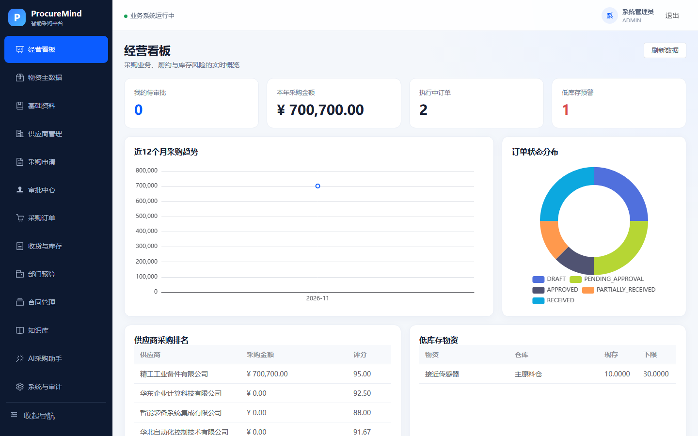
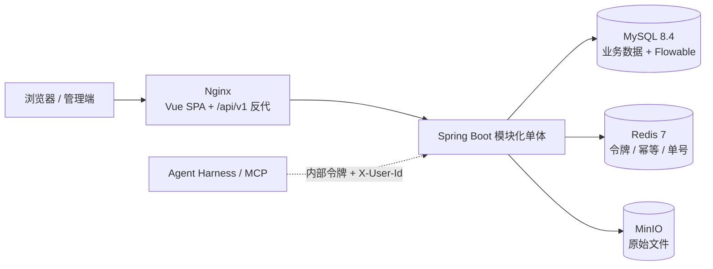

# ProcureMind 智能采购平台

面向制造企业的采购与物资供应链全栈项目，覆盖“采购申请 → 多级审批 → 采购订单 → 分批收货 → 库存入账”的核心闭环，适合作为 Spring Boot + Vue 的企业级项目实践与面试演示。

前后端业务系统与 `procurement-agent-harness` 在源码和运行时上解耦；不启动 Agent 时，登录、审批、订单、收货、库存和看板均可独立运行。项目地址：[q2392044156/smart-procurement-platform](https://github.com/q2392044156/smart-procurement-platform)。



> 更多界面截图与 6 帧演示 GIF 见 `docs/screenshots/`，三分钟演示脚本见 `docs/DEMO.md`。

## 项目结构

```text
smart-procurement-platform/
├── backend/                  # Spring Boot 模块化单体、Flyway、Flowable
├── frontend/                 # Vue 3 管理端、Vitest、Playwright
├── infra/                    # MinIO 等基础设施镜像配置
├── scripts/                  # 演示数据与端到端业务验收脚本
├── samples/                  # 知识库示例文档（DOCX/PDF）与生成脚本
├── docs/                     # 架构边界和模块依赖说明
├── compose.yml               # 本地一键启动编排
└── .env.example              # 可复制的环境变量模板
```

## 技术架构

- `frontend/`：Vue 3、TypeScript、Vite、Pinia、Element Plus、ECharts
- `backend/`：Java 21、Spring Boot 3.5、Spring Security、JdbcTemplate（统一 SQL 访问）、Flowable 7.2、Flyway
- 基础设施：MySQL 8.4、Redis 7、MinIO、Docker Compose
- 可选智能能力：同级目录 `../procurement-agent-harness`，通过 Spring Boot 代理 SSE

## 架构一览



- 浏览器只访问 `/api/v1/**`；`/api/**` 是 Agent 内部工具面，Nginx 固定 404，必须经过内部令牌过滤器和业务权限判定。
- 业务模块之间不互相访问内部实现：文件、知识库、预算、合同通过公开 Service 与扩展点协作（如 `FileReferenceChecker`）。
- Agent 只负责“理解与编排”，权限、数据范围、状态机、幂等与审计仍由平台裁决。

## 完整启动与关闭

推荐使用 Docker Compose 一键启动。前置条件：

- Git
- Docker Desktop 及 Docker Compose v2
- 本机 `3000`、`8080`、`9000`、`9001` 端口未被占用

首次运行：

```powershell
git clone https://github.com/q2392044156/smart-procurement-platform.git
cd smart-procurement-platform
Copy-Item .env.example .env
docker compose up -d --build
docker compose ps
```

正常运行时 `mysql`、`redis`、`minio`、`backend` 应显示 `healthy`，`frontend` 应显示 `Up`。查看启动日志：

```powershell
docker compose logs -f backend frontend
```

访问入口：

- 管理端：http://localhost:3000
- Swagger：http://localhost:8080/swagger-ui.html
- MinIO 控制台：http://localhost:9001
- 后端健康检查：http://localhost:8080/actuator/health

Flyway 会自动建表，应用首次启动自动写入 BCrypt 演示账号和制造业演示主数据。

完整关闭但保留 MySQL、Redis、MinIO 数据卷：

```powershell
docker compose down
```

只停止前后端、继续保留基础设施：

```powershell
docker compose stop frontend backend
```

恢复：`docker compose start`。只有在确认需要清空全部业务数据时才执行 `docker compose down -v`；该命令会删除数据库、缓存、文件和 Agent MongoDB 数据卷。

## 演示账号

| 角色 | 账号 | 密码 |
|---|---|---|
| 系统管理员 | `admin` | `Admin@123` |
| 申请人 | `requester` | `Request@123` |
| 部门经理 | `manager` | `Manager@123` |
| 采购员 | `purchaser` | `Purchase@123` |
| 财务 | `finance` | `Finance@123` |
| 仓管员 | `warehouse` | `Warehouse@123` |
| 总经理 | `gm` | `Gm@123` |
| 审计员 | `auditor` | `Audit@123` |
| 质量部门经理（扩展示例） | `quality` | `Quality@123` |
| 质量部申请人（部门范围测试） | `quality.requester` | `QualityReq@123` |
| 采购只读观察员（扩展示例） | `viewer` | `Viewer@123` |
| 主数据管理员（扩展示例） | `masterdata` | `MasterData@123` |
| 供应商管理员（扩展示例） | `supplieradmin` | `Supplier@123` |

角色职责：申请人创建、编辑和提交本人申请；部门经理审批本部门申请；采购员维护供应商、把已批准申请转订单并提交订单；财务审批中高金额申请及订单商业条款；仓管员执行分批收货并查看库存；总经理审批高金额申请；审计员只读业务数据并查看操作审计；主数据管理员维护物资分类、物资、仓库、单位和品牌；供应商管理员维护供应商档案、联系人、资质及绩效；系统管理员拥有全部菜单和数据范围。

建议演示顺序：申请人创建并提交申请 → 根据金额切换对应审批账号 → 采购员转换并提交订单 → 财务/总经理审批 → 仓管员分批收货 → 查看库存余额、流水及看板。

审批规则：5万元以下为部门经理、采购经理；5万至50万元增加财务；50万元及以上再增加总经理。申请人兼任当前审批角色时自动跳过该节点。

## 管理端已实现操作

- 物资主数据：完整增删改查、启停物资，维护树形分类及文本、数值、布尔、日期、枚举动态属性；阻止修改已有库存历史的跟踪方式，并对分类属性变更做存量数据兼容检查。
- 基础资料：完整增删改查和启停仓库、计量单位及品牌；展示业务引用数量，对已产生采购或库存引用的数据执行删除/停用保护。
- 供应商：完整维护供应商档案、多个联系人及主要联系人、准入/合格/暂停/黑名单状态、资质证照附件和季度绩效评价；系统自动识别资质有效期、回算综合评分，并保护已有采购订单和合格供应商的最后一项有效资质。
- 采购申请：新建、编辑草稿或驳回单、提交、取消、软删除、查看明细及审批时间线；审批后按明细调整订单单价并转换订单。
- 审批中心：审批前预览完整单据，填写意见后通过或驳回，查看已办任务。
- 采购订单：编辑供应商、交期、税率、条款和单价，提交审批，按状态取消、关闭或软删除，并查看审批时间线。
- 采购附件：申请和订单均支持 PDF、图片及二进制资料的 MinIO 预签名上传、分类、说明、下载和安全移除。
- 库存与看板：仓管员可分批收货并校验剩余数量、批次号和序列号；可查看收货单完整明细、库存余额、流水、采购趋势、订单状态及供应商排名。
- 系统与审计：完整维护用户、组织树和自定义角色；支持多角色分配、数据范围、功能权限、账号/角色/部门启停、密码重置、软删除、内置角色及最后管理员保护，并查看权限清单和操作审计。
- 知识库：内部制度、流程、合同、供应商资料与模板的统一归档；支持 DOCX/PDF 等文档上传、分类与标签、归属部门、五档可见范围（全员/本部门/本部门及下级/仅创建人/指定用户或角色）、草稿-发布-归档状态流转、版本历史与回滚留痕、权限校验下载，并对被引用的文件做删除保护。
- 列表与提醒：物资、供应商、采购申请、采购订单、收货、库存余额与流水均提供分页接口（管理端主列表已接入）；提供资质临期/过期、交付临期/逾期、审批积压三类提醒查询，供看板与 Agent 使用；上传文件在关联业务时回读文件头校验真实类型。
- 出库与领用：仓管员按仓库与物资登记领用，校验库存余额与批次号/序列号，扣减余额并写入 OUT 流水；库存从“只增不减”变为完整出入库闭环。
- 部门预算：维护部门年度预算，申请提交与直采下单时校验可用额度，预算页展示额度、占用、可用与使用率。
- 合同管理：合同台账（编号、供应商、金额、起止日期、类型），可关联采购订单并校验供应商一致性，支持草稿-生效-到期/终止流转。

后端按业务模块组织；Controller 只负责 HTTP 适配，业务规则和 SQL 下沉到 Service。详细边界见 `docs/ARCHITECTURE.md`。

## 启用 Agent（可选）

准备好 `../procurement-agent-harness/.env` 后，先在平台 `.env` 中把 `AGENT_INTERNAL_TOKEN` 改为至少32位的随机值，并让 Agent/MCP 使用同一个值。占位值或 `change-me` 会被后端拒绝启动：

```powershell
$env:AGENT_ENABLED='true'
docker compose --profile agent up -d --build
```

关闭包含 Agent 的整套服务：`docker compose --profile agent down`。

该 profile 会额外启动 Agent API、MCP 网关和 Agent 专用 MongoDB。Spring 会从 JWT 中提取用户身份并覆盖浏览器传入的用户字段；MCP 再用内部令牌、用户 ID 与请求 ID访问业务后端。Agent 未启用或不可用时，AI 接口返回 503，但不影响业务接口。

内部工具面按用途分组：供应商/物资/订单/库存（读写）、采购申请/审批待办/收货记录/经营看板（只读）、知识库检索（可见文档、增量变更、原文地址）。订单状态出参统一为字符串枚举，入参兼容历史数字编码；写接口支持 `Idempotency-Key`，未传时按内容指纹去重，Agent 重试不会重复建单。完整契约见 `docs/AGENT_TOOL_CONTRACT.md`。

## 本地开发

本地开发需要 JDK 21、Maven 3.9+、Node.js 20.19+ 和 npm 10+。先启动基础设施：`docker compose up -d mysql redis minio`，再分别打开两个终端：

```powershell
cd backend
mvn spring-boot:run
```

```powershell
cd frontend
npm install
npm run dev
```

前端开发服务器将 `/api` 代理到 `http://localhost:8080`。

开发模式关闭方式：在前后端两个终端中按 `Ctrl+C`，然后执行 `docker compose down` 关闭基础设施。

## 配置说明

本地首次启动应复制 `.env.example` 为 `.env`。`.env` 已被 Git 忽略，不应提交真实密钥。

| 变量 | 用途 | 说明 |
|---|---|---|
| `DB_PASSWORD` | MySQL 业务账号密码 | 部署时必须修改 |
| `MYSQL_ROOT_PASSWORD` | MySQL root 密码 | 部署时必须修改 |
| `MINIO_ACCESS_KEY` / `MINIO_SECRET_KEY` | MinIO 凭据 | 部署时必须修改 |
| `MINIO_PUBLIC_ENDPOINT` | 浏览器访问 MinIO 的地址 | 远程部署应使用 HTTPS 公网/内网域名 |
| `JWT_SECRET` | JWT 签名密钥 | 至少 32 字节随机值 |
| `AGENT_ENABLED` | 是否启用可选 Agent | 默认 `false` |
| `AGENT_INTERNAL_TOKEN` | 平台与 Agent 的内部令牌 | 仅启用 Agent 时配置，至少 32 字节 |

## API 约定

- REST API 前缀：`/api/v1`
- 统一响应：`{ code, message, data, requestId }`
- Long 主键和金额以字符串形式传输，避免 JavaScript 精度丢失
- 数据库存储 UTC 时间，前端按 `Asia/Shanghai` 展示
- Swagger：<http://localhost:8080/swagger-ui.html>
- OpenAPI JSON：<http://localhost:8080/v3/api-docs>

## 自动化验收

提交代码前建议执行基础测试与构建。`mvn test` 除单元测试外，会通过 Testcontainers 启动 MySQL 8.4 与 Redis 容器，跑一遍登录、知识库、采购申请与提醒接口的真实 HTTP 集成测试（需要本机 Docker）：

```powershell
cd backend
mvn test
cd ..\frontend
npm ci
npm run test
npm run build
```

仓库内置 `.github/workflows/ci.yml`，推送或提交 PR 时自动执行后端测试（含 Testcontainers 集成测试）与前端构建、单元测试。

默认服务健康后，可以执行可重复的端到端业务验收：
```powershell
.\scripts\acceptance-smoke.ps1
```

执行用户、部门、角色和权限 CRUD 专项验收（测试产生的临时数据会自动清理）：

```powershell
.\scripts\system-management-smoke.ps1
```

该脚本验证新增与编辑部门、自定义角色及权限实时生效、用户新增与多角色分配、启停、密码重置、删除约束、最后管理员保护和 PATCH 操作审计。

执行第二批主数据 CRUD 专项验收（测试产生的临时数据会自动清理）：

```powershell
.\scripts\master-data-smoke.ps1
```

该脚本使用主数据管理员账号真实调用 API，验证仓库、单位、品牌、分类和物资的增删改查、启停、动态属性类型/必填校验、属性定义兼容升级、编码保护、业务引用保护、只读角色越权拦截和 PATCH 操作审计，并确认 V6 内置演示数据可用。

执行第三批供应商全生命周期专项验收（临时供应商、联系人、资质、评价及 MinIO 文件会自动清理）：

```powershell
.\scripts\supplier-management-smoke.ps1
```

该脚本验证供应商档案和编码保护、多个联系人及主要联系人同步、实际 PDF 预签名上传/下载/删除、有效资质准入约束、绩效总分与供应商评分回算、重复期间和评分范围校验、订单引用删除保护、只读越权拦截及操作审计。

执行第四批采购单据管理专项验收（临时申请、订单和附件会自动清理）：

```powershell
.\scripts\procurement-document-smoke.ps1
```

该脚本验证申请取消/删除、审批中流程终止、订单编辑/取消/删除、来源申请状态恢复、真实 MinIO 附件上传下载、越权拦截和收货明细读取。完整闭环脚本还会验证已收货订单关闭。

执行知识库功能验收（真实上传 `samples/knowledge` 下的 DOCX 与 PDF，覆盖发布、部门/角色可见性、版本、归档、删除、文件引用保护和审计，数据自动清理）：

```powershell
python .\scripts\knowledge-base-smoke.py
```

该脚本仅依赖 Python 3.10+ 标准库，默认访问 `http://localhost:3000`，也可传入其他入口地址。

执行 Agent 内部工具面验收（需以 `AGENT_ENABLED=true` 启动，覆盖内部令牌、权限、数据范围、状态口径、幂等、只读工具面与知识库检索接口）：

```powershell
python .\scripts\agent-contract-smoke.py
```

该脚本直连后端 `http://localhost:8080`（内部接口不经 Nginx 暴露），接口清单与口径见 `docs/AGENT_TOOL_CONTRACT.md`。

执行 P1 验收（列表分页、Redis 单号序列、到期/超时提醒、上传内容校验）：

```powershell
python .\scripts\p1-acceptance-smoke.py
```

执行 P2 验收（出库/领用、预算控制、合同管理）：

```powershell
python .\scripts\p2-acceptance-smoke.py
```

脚本通过 Nginx 入口真实调用 API，覆盖角色权限与数据范围、三档金额审批链、驳回重提及多流程历史、申请转订单、订单审批、分批收货、幂等重放、超量收货、批次号校验、序列号唯一性以及库存余额一致性。脚本会写入带“验收”用途的演示单据。

浏览器端登录、菜单权限和越权路由由 Playwright 验证：

```powershell
cd frontend
npx playwright install chromium
npm run test:e2e
```

## 业务展示数据

默认主数据之外，可在服务健康后生成一组通过真实 REST 接口和 Flowable 流程流转的业务展示数据：

```powershell
.\scripts\seed-showcase-data.ps1
```

脚本使用 `[业务展示数据-v1]` 标记，正常重复执行会返回 `SKIPPED`，不会重复写入。`-Force` 会额外生成一整组新业务场景。

展示数据包括：

- 待准入、暂停合作、黑名单三种供应商状态，以及有效、即将到期、已过期资质和多季度绩效评价。
- 草稿、等待部门经理、等待采购经理、等待财务、等待总经理、已驳回、已批准、已转订单的采购申请。
- 草稿、等待财务、等待总经理、已批准、部分收货、批次物资已收货、序列号物资已收货的采购订单。
- 数量、批次、序列号三种库存余额和对应收货流水，供库存页面、经营看板和不同角色待办直接展示。
- 第二批固定主数据：质量检验仓、千克单位、欧姆龙品牌、带“精度等级”枚举属性的工装量具分类，以及按序列号跟踪的数显扭矩扳手。
- 第三批固定数据：华北自动化控制技术有限公司、两名业务/售后联系人、两项有效资质和两个季度绩效评价，供供应商全生命周期页面展示。
- 第四批固定数据：可编辑申请、已取消申请和可编辑订单，供取消、删除、商业条款维护及附件操作演示。

## 关键业务约束

- 采购申请：`DRAFT → PENDING_APPROVAL → APPROVED/REJECTED → CONVERTED/CANCELLED`
- 采购订单：`DRAFT → PENDING_APPROVAL → APPROVED → PARTIALLY_RECEIVED → RECEIVED → CLOSED`
- 已审批申请才能转换订单；已审批订单才能收货
- 批次物资必须登记批次号；序列号物资逐个登记且全局唯一
- 收货与库存入账处于同一事务；余额使用乐观锁；写入接口通过 `Idempotency-Key` 防重
- 金额使用 `DECIMAL(18,2)` / `BigDecimal`，Long ID 和金额在 JSON 中序列化为字符串

## 关键设计取舍

| 决策 | 选择 | 理由 | 代价 |
|---|---|---|---|
| 工作流 | Flowable 7 BPMN | 金额分档、跳过节点、历史可查，自研状态机很快失控 | 启动慢、表多、需要理解 BPMN |
| 数据访问 | JdbcTemplate 手写 SQL | 数据范围、聚合、分页是核心复杂度，ORM 反而碍事 | SQL 会重复，只能靠测试兜底 |
| 认证 | JWT + Redis 刷新令牌轮换 | 访问无状态，刷新可撤销 | 前端要处理刷新竞态（已做单飞） |
| Agent 接入 | 内部令牌 + 用户身份透传的防腐层 | Agent 不持有超级权限，权限仍由平台判定 | 工具面需随业务接口同步演进 |
| 写操作幂等 | 显式 Key 或内容指纹 | Agent 会重试，重复建单不可接受 | 窗口内相同请求会被合并 |
| 知识库可见性 | 检索**前**过滤可见文档 | 事后过滤等于无权限内容已进入模型上下文 | 检索服务需按用户缓存可见集合 |
| 文件安全 | 预签名直传 + 关联时回读魔数 | 大文件不经应用层中转，又能校验真实类型 | 病毒扫描仍需外部服务 |
| 单号 | Redis 按天自增 | 毫秒时间戳并发会撞号 | 依赖 Redis 可用性 |

## 演示与部署

- 三分钟演示脚本：[docs/DEMO.md](docs/DEMO.md)
- 部署与常见问题：[docs/DEPLOYMENT.md](docs/DEPLOYMENT.md)
- Agent 工具契约：[docs/AGENT_TOOL_CONTRACT.md](docs/AGENT_TOOL_CONTRACT.md)
- 一键启动：`.\scripts\demo-up.ps1 -Build`（自动处理 9000 端口冲突）
- 界面截图与 6 帧演示 GIF：`docs/screenshots/`（`demo.gif`）

## 当前边界与安全说明

- 核心采购闭环和角色权限可独立演示，但它仍是面试展示型 MVP，不等同于生产级 ERP。询报价、合同、发票、三单匹配、质检、资产维保、消息通知和多租户不在首版范围。
- 文件服务已限制类型、大小、删除条件及下载者身份，并支持供应商资质、采购申请和采购订单附件；生产部署仍应增加病毒扫描、内容嗅探与对象生命周期策略。
- Docker 默认将 `MINIO_PUBLIC_ENDPOINT` 设为 `http://localhost:9000`。远程部署时必须改为浏览器可访问的 MinIO HTTPS 地址，否则预签名 URL 无法从客户端使用。
- 内部旧 Agent API 在 Agent 关闭时返回404，Nginx不向浏览器代理该路径；启用后同时校验强内部令牌、用户身份和业务权限。
- Compose 对外端口仅绑定 `127.0.0.1`。若部署到服务器，必须更换所有演示密码和 `.env` 密钥，并在反向代理上启用 HTTPS、限制 Swagger/MinIO 控制台访问。
